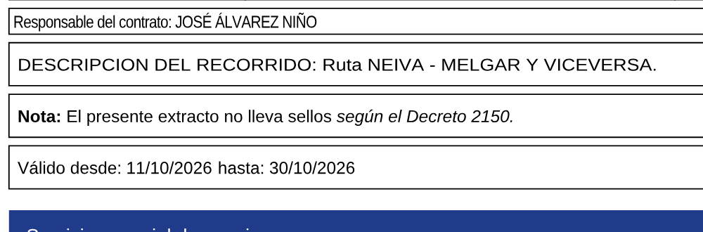
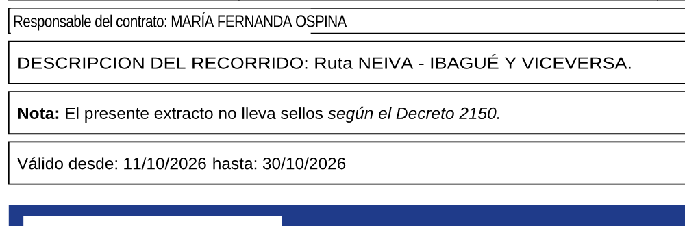
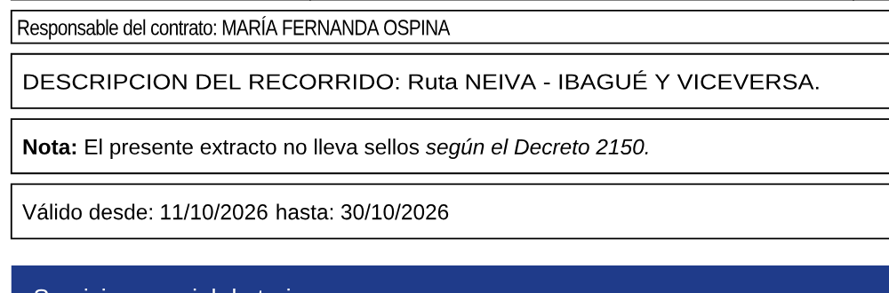

# Fidelidad del editor de texto — decisión técnica

Objetivo: editar un texto de un PDF y que, al exportar, sea imposible distinguir a simple vista lo editado
de lo original (mismas líneas de fondo, misma fuente, grosor, ancho, espaciado, color y alineación).

## 1. Spike: enfoques comparados

Se compararon sobre un PDF **sintético** (`tests/fixtures/fuec-sintetico.pdf`, generado por
`tests/fixtures/make-fuec.mts`) que reproduce un formato FUEC: tabla con bordes, Arial condensada
(Tz 85, Tc −0.25), línea fragmentada y ensanchada (Tz 110), campos a la derecha y centrados, TJ con kerning,
negrita/cursiva mezcladas, fuentes estándar (Helvetica/Times/Courier), Carlito (≈ Calibri) y una fuente propia
incrustadas como subconjunto, texto sobre color y sobre degradado, imagen de cabecera, QR, texto dentro de un
Form XObject y una segunda página.

Medición: render con pdf.js a 200 DPI antes/después y comparación de píxeles.

| Enfoque | Líneas y fondo | Eliminación parcial (solo una fecha dentro de un TJ) | Reescribir con la fuente original | Peso / licencia |
| --- | --- | --- | --- | --- |
| **A. Eliminación en el content stream (propio)** | Intactos (0 px distintos fuera del texto) | Sí, sin mover lo demás | **Sí** | ~0 KB extra, MIT/propio |
| B. Redacción con MuPDF (WASM) | Intactos | Por rectángulo (todo glifo que toque el área) | No (solo elimina) | 9.9 MB WASM, **AGPL-3.0** |
| C. Tapar con rectángulo (método anterior) | **Bordes cortados**, fondos manchados | No | No | — |

**Ganó A.** Elimina tan limpio como MuPDF, permite quitar glifos sueltos sin mover el resto y es lo único que
habilita escribir el texto nuevo con **la misma fuente incrustada del PDF** (y por tanto un resultado idéntico).
MuPDF queda documentado como alternativa (ver §5). El tapado (C) solo se usa como respaldo explícito.

Evidencia (PDF sintético; arriba original, en medio el método anterior, abajo el nuevo):





En el método anterior se ven el borde izquierdo y superior cortados en la celda ajustada y el parche blanco en
la banda azul; en el nuevo, bordes y banda intactos y el texto conserva la condensación.

Con el **FUEC real** (solo prueba manual local, nunca en el repositorio): la «prueba de oro» de reescribir las
77 líneas con el mismo texto dio **89 píxeles distintos de 3 866 367 (0.0023 %)**, ruido de antialias.

## 2. Arquitectura

```
src/lib/editor/pdf/
  tokenizer.ts   Tokenizador de content streams; reescritura por empalme (lo no tocado queda byte a byte)
  interpret.ts   Estado gráfico y de texto: fuente, tamaño, Tz, Tc, Tw, Ts, color, CTM y posición de cada glifo;
                 líneas rectas (bordes de tabla); Form XObjects recursivos
  fonts.ts       Anchos por código, ToUnicode/codificaciones, codificación inversa y comprobación de que el
                 glifo existe en el subconjunto incrustado (fontkit)
  decrypt.ts     Manejador de seguridad estándar (RC4, AES-128, AES-256) para PDFs que abren sin contraseña
  rewrite.ts     Eliminación por glifo (desplazamiento TJ equivalente) e inserción en el mismo punto del stream
  layout.ts      Composición del texto nuevo: alineación LCS con el original, estilos por carácter,
                 sustitución de letras ausentes, escala/«ajustar al ancho» y escritura de operadores
  blocks.ts      Detección de líneas editables (sin cruzar bordes), alineación en la celda y espacio disponible
  text-edits.ts  Orquestación por página: eliminar + escribir; informe por edición
  subfonts.ts    Métricas de las fuentes sustitutas (idénticas en navegador y exportación)
```

Claves de la fidelidad:

1. **Eliminación limpia**: cada glifo eliminado se sustituye en el `TJ` por un número equivalente a su avance
   exacto (incluidos `Tc` y `Tw`), así los glifos que quedan no se mueven. Nada más del stream cambia.
2. **Inserción en el sitio**: el texto nuevo se escribe justo después de la última operación original de la
   línea (`ET q … Q BT` + restauración de `Tm/Tlm`), por lo que hereda el **mismo recorte (clip)**, el mismo
   orden de dibujo (lo que se pintó después sigue encima) y el mismo estado gráfico. Esto resultó decisivo
   con el FUEC real, que recorta cada texto a su celda.
3. **Misma fuente**: se usa el recurso de fuente original con sus códigos (subconjunto incluido). Las letras que
   no existen en el subconjunto se escriben con la sustituta métricamente compatible y **se listan una a una**
   en el inspector.
4. **Mismas métricas**: Tz, Tc, Tw, elevación, color (incluidos espacios de color con nombre) y matriz de texto
   original (muchos generadores usan `Tf 1` y condensan con la matriz; se respeta).
5. **LCS carácter a carácter**: lo que no cambia conserva posición, kerning, huecos entre fragmentos y estilo
   (negrita parcial…). Cambiar un dígito no mueve nada más.
6. **WYSIWYG**: el editor genera la vista previa de la página con la **misma función** que la exportación y la
   renderiza con pdf.js; el campo de edición es transparente (solo cursor).

## 3. Tabla de sustitución

| Fuente original | Sustituta incluida |
| --- | --- |
| Arial, ArialMT, Helvetica, Arimo | Liberation Sans (métricas de Arial) |
| Times New Roman, Times, Tinos | Liberation Serif |
| Courier New, Courier, Cousine | Liberation Mono |
| Calibri | Carlito |
| Cambria | Caladea |
| Inter, Roboto, Open Sans, Montserrat, Lora | la misma (incluida) |
| Otra | por familia (serif/sans/mono) con su peso e inclinación; o la fuente que subas (.ttf/.otf) |

## 4. Límites honestos (se avisan en pantalla)

- **Letras ausentes en un subconjunto**: no se pueden crear con la fuente original; se escriben con la sustituta
  y el inspector dice exactamente cuáles. Si ninguna fuente disponible tiene un carácter, se marca como
  imposible de dibujar.
- **Respaldo de tapado** (se indica «Cubierto con color»): fuentes Type3, CMaps distintas de Identity-H,
  escritura vertical, contenido que no se pudo interpretar. El rectángulo se ajusta al texto real.
- **PDF escaneado** (solo imagen): no tiene texto editable; se avisa. OCR queda como mejora futura.
- **PDF con contraseña de apertura**: no se edita (se informa). Los PDFs con restricciones que abren sin
  contraseña se descifran en memoria y el exportado queda sin cifrar ni restricciones.
- **Párrafos**: se edita por líneas (con estilos mixtos dentro de la línea); la agrupación en párrafos
  multilínea queda pendiente.
- **Antialias en bordes de recorte**: al repintar dentro de un clip puede variar una fila de píxeles del borde
  (invisible); las pruebas lo toleran explícitamente.
- **Compatibilidad**: el PDF exportado se verificó con pdf.js (motor de las pruebas), Vista Previa de macOS
  (Quartz) y MuPDF. Acrobat Reader no estaba disponible en este entorno para probarlo.

## 5. Licencias y alternativa

- El enfoque elegido no añade dependencias nuevas de producción (pdf-lib, fontkit y pdf.js ya estaban).
- **MuPDF (mupdf.js)** es AGPL-3.0: aceptable para una herramienta personal, pero obligaría a publicar el código
  si la app se ofreciera a terceros. Solo se usó fuera del proyecto, en el spike y para generar los PDFs cifrados
  sintéticos de las pruebas (`tests/fixtures/fuec-sintetico-*.pdf`).
- Alternativa permisiva si algún día se necesita un motor completo: **PDFium** compilado a WASM (BSD/Apache),
  que permite eliminar objetos de texto de la página.

## 6. Pruebas automatizadas

`npm test` — `tests/text-fidelity.test.ts` y `tests/decrypt.test.ts`:

- Líneas intactas: fuera del texto editado, 0 píxeles distintos (incluidos los bordes de una celda ajustada).
- Prueba de oro en 17 casos (condensado, ensanchado y fragmentado, negrita/cursiva, kerning, derecha, centrado,
  blanco sobre color, degradado, Helvetica/Times/Courier, Carlito, fuente propia, XObject, `Tf 1` con matriz,
  recorte, orden de dibujo).
- Ancho ±1 % con texto del mismo largo; «ajustar al ancho» ±0.5 % sin salirse de la celda; cambiar un dígito no
  mueve el resto.
- Tildes y ñ en el PDF y al extraer/copiar el texto; letras sustituidas informadas exactamente.
- Vista previa = exportación (comparación de píxeles); varias líneas y varias páginas; respaldo de tapado.
- Descifrado RC4-128, AES-128 y AES-256; error claro con contraseña de apertura.
